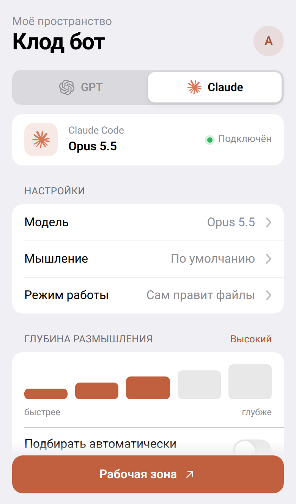
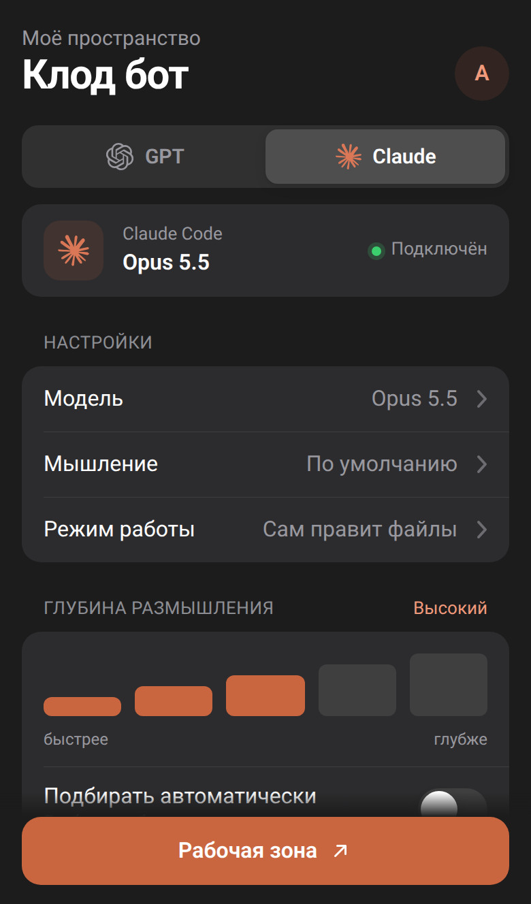
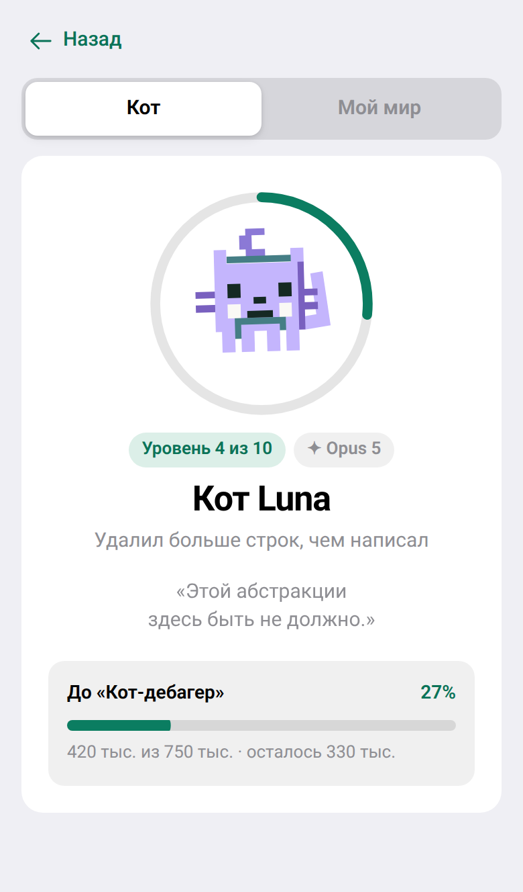
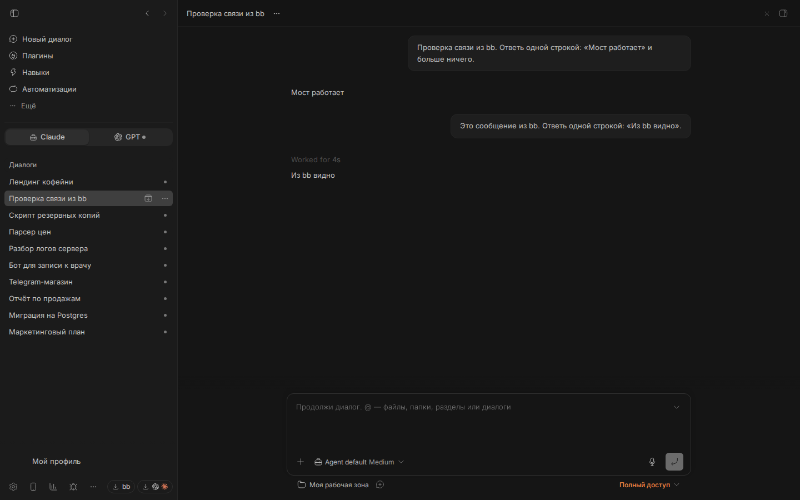
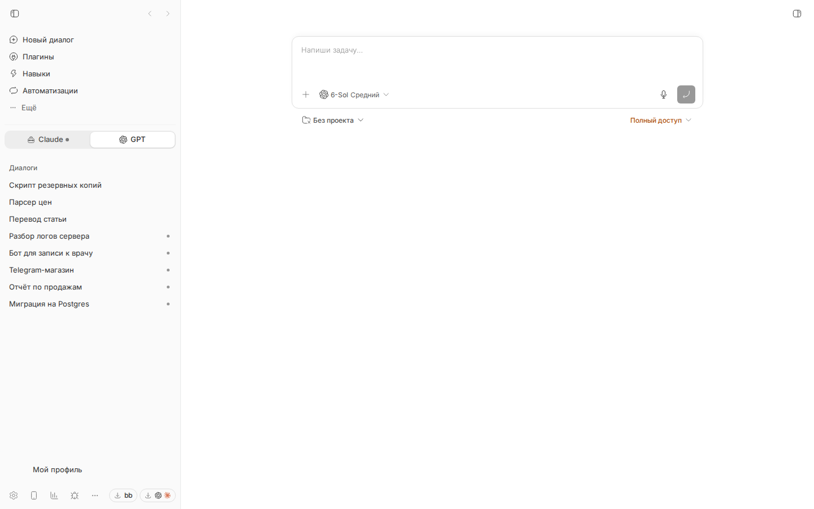
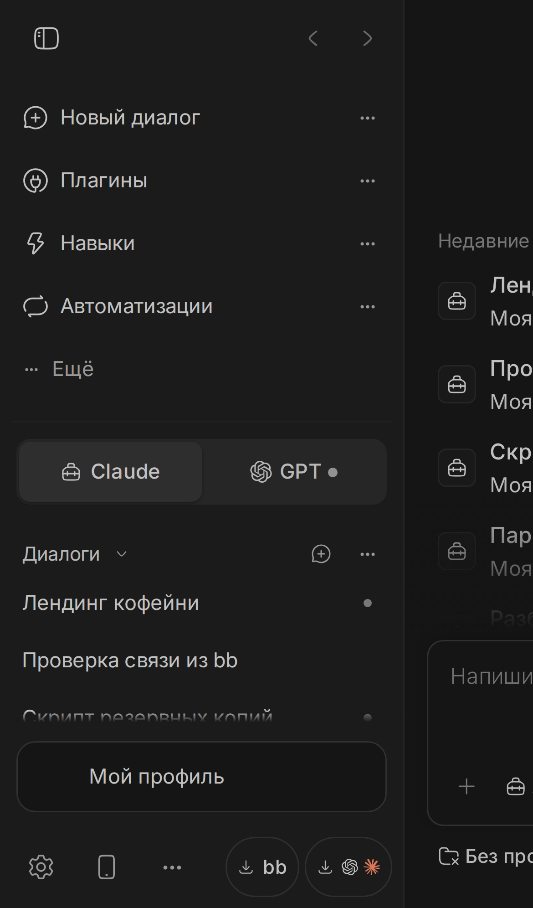
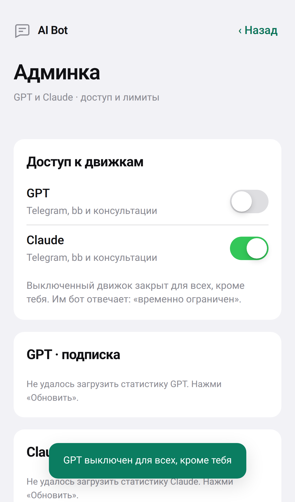
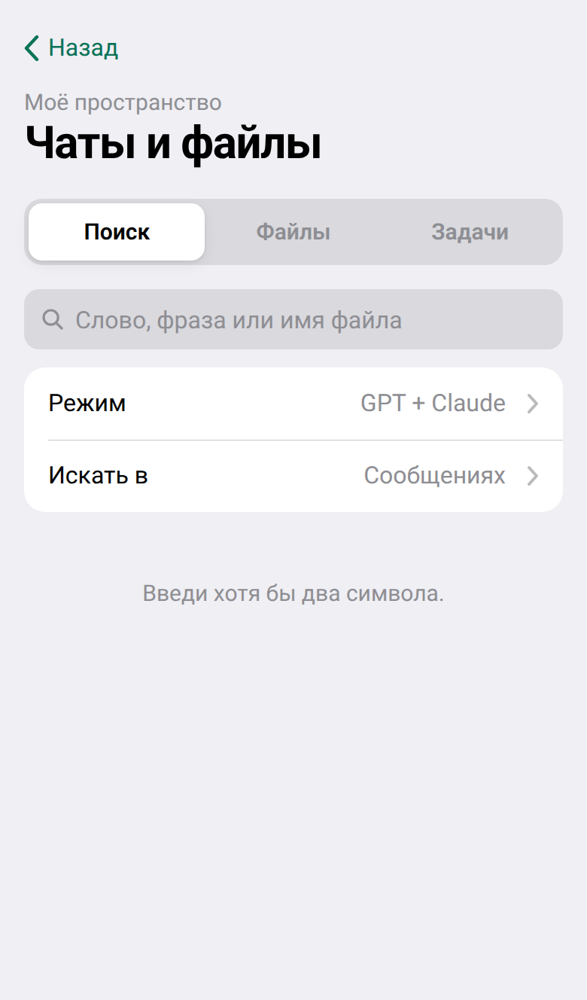

<div align="center">

# AI Bot

**Claude Code и GPT Codex в одном Telegram-боте — с мини-аппом и рабочей зоной в браузере**

Пишешь задачу в Telegram — агент работает в своей папке: читает и правит файлы, запускает команды, ходит в интернет, присылает результат. Переключаешься между Claude и GPT одной кнопкой, а продолжить можно в браузере с того же места.

[Открыть бота → @AI_wIw_bot](https://t.me/AI_wIw_bot)

  

</div>

## Что умеет

**Два движка в одном чате**
- **Claude Code** (Agent SDK) — Opus, Sonnet, Fable; глубина размышления (Low…Extra High), режимы работы от «спрашивать на всё» до «без вопросов» — в нём агент вообще ничего не спрашивает.
- **GPT Codex** — модели GPT по подписке ChatGPT; список моделей подтягивается сам из каталога Codex — новые модели появляются без правок кода.
- Переключатель движка в Telegram и мини-аппе. У каждого движка своя история диалогов, `/resume` — вернуться к любому.
- **Голосовые**: надиктовал задачу — бот расшифровал и выполнил. Ответ голосом — на выбор: текстом, голосом на голосовые или всегда (`/voice` или мини-апп).
- **Картинки**: «нарисуй …» в любом режиме — генерация через встроенный инструмент GPT, файл приходит в чат.

**Агент, который делает, а не только отвечает**
- Отдельная папка на каждый диалог, файлы приходят в чат. Ответы с отступами между абзацами — читать с телефона легко.
- Изоляция: у каждого пользователя свой Linux-пользователь для Claude и свой Docker-контейнер для GPT (только чтение корня, без лишних прав). Новому человеку изолированный Claude Code создаётся сам за несколько секунд.
- Весь трафик к моделям — через защищённый прокси: упал туннель — бот встаёт, а не ходит мимо.
- **Оркестрация агентами**: большие задачи модель раскладывает на субагентов и перепроверяет. Готовые сценарии — `/workflows`: `/review`, `/plan`, `/audit`, `/fix-until-green`, `/compare`, `/explain`, `/fact-check`, `/server-check`, `/karta`.

**Мини-апп в Telegram**
- Модель, глубина размышления, режим работы, лимиты подписки Claude (пятичасовое и недельное окно, время сброса по МСК) и расход GPT.
- Поиск по чатам и файлам обоих движков, задачи, кот-компаньон и «Мой мир» за работу в боте.
- Нативный вид Telegram, светлая и тёмная тема.

**Рабочая зона в браузере (bb)**
- Те же диалоги, что в Telegram: вкладки **Claude | GPT** над списком диалогов.
- Claude-диалог из браузера ведёт тот же движок, что и Telegram — одна история, продолжай где удобно. Пока диалог отвечает в одном месте, второе ждёт.
- GPT-диалоги синхронизируются в обе стороны: начатый в браузере появляется в боте с историей и продолжается оттуда.
- Сменил движок посреди диалога — новый получает скрытую сводку того, что сделал прежний.



 

**Админка**
- Пользователи и приглашения по ссылке: человек открывает ссылку и сразу получает GPT и Claude с настройками по умолчанию.
- Личные лимиты **в процентах недели подписки** — и у GPT, и у Claude (новичкам по 10%). В списке видно, кто сколько потратил; на 80% бот сам предупреждает человека.
- Выключатели **GPT / Claude**: закрытый движок недоступен всем, кроме владельца, — бот отвечает «временно ограничен» в Telegram, браузере и консультациях.

 

**Сам за собой следит**
- Каждую ночь бот проверяет новую версию Claude Code: собирает её в стороне, прогоняет тесты, подменяет только когда нет задач, при сбое откатывается и пишет владельцу отчёт.
- Codex (GPT) тоже обновляется сам: новый образ контейнеров, проверочный ход в отдельном контейнере, переключение в тишине со снимками баз и откатом. Про новые версии bb приходит уведомление — его фронт пропатчен, переносится осознанно.
- Ночной бэкап баз, настроек и папок пользователей (14 и 3 последних копии), чистка старых релизов.
- Сторож каждые 2 минуты: упала служба, бот не отвечает, кончается место, не прошёл бэкап — владельцу приходит сообщение, а потом «починилось».
- Субагенты Claude держат кэш промпта час, а не 5 минут, — меньше лишнего расхода лимита.

## Как устроено

```
Telegram ──► ai-bot (Node, dist/index.js) ── Claude Agent SDK ─► Claude Code (под uid пользователя)
               │  мини-апп :8788                  │
               │                                  └─ data/claude-bb.sock ◄── мост для браузера
               ▼
          ai-gpt-backend (gpt/main.mjs) ── Docker-контейнер пользователя ─► Codex CLI, bb
               │  шлюз рабочей зоны :8792 (bb в браузере)
               └  вход 172.30.0.1:8790 (модели GPT, команда ИИ, мост Claude)

Все внешние запросы ─► ai-bot-proxy (Xray, fail-closed nftables)
```

| Путь | Что там |
|---|---|
| `src/` | бот Claude: Telegram, мини-апп, сессии, лимиты, мост `bb-bridge.ts`, выключатели `engine-access.ts` |
| `gpt/` | бэкенд GPT: Codex, шлюз рабочей зоны, команда ИИ, зеркала диалогов, каталог моделей `gpt-models.mjs` |
| `src/miniapp/public/` | мини-апп (собирается копированием в `dist/miniapp/public/`) |
| `claude-workflows/` | готовые воркфлоу Claude Code (раскладываются каждому в `~/.claude/workflows`) |
| `scripts/` | автообновление, бэкап/чистка/сторож (`ops.py`), исполнители Claude (`claude-workers.py`), перевод и патчи фронта bb (`bb-engine/`), сжатие ассетов |
| `test/`, `gpt/*.test.mjs` | тесты |
| `КАРТА.md` | шпаргалка по серверу: службы, выкатка, откат, логи |

## Запуск и проверка

[](https://github.com/meloch287/claude-telegram/actions/workflows/ci.yml) — сборка и все тесты на каждый пуш.

```sh
npm ci
npm run build                          # tsc + сборка мини-аппа
npm test                               # node --test gpt/*.test.mjs
npx tsx --test test/*.test.ts          # логика бота (нужны BOT_TOKEN, ENCRYPTION_KEY, DATA_DIR)
python3 scripts/ops.test.py            # бэкап, чистка, сторож
python3 scripts/worker-update.test.py  # обновление Codex в контейнерах
```

Настройки — в `.env` (пример: `.env.example`): токен бота, ключ шифрования, папки данных и рабочих зон, прокси. Секреты в репозиторий не попадают.

На сервере бот работает как службы systemd: `ai-bot` (Claude, Telegram, мини-апп), `ai-gpt-backend` (GPT и рабочая зона), `ai-bot-proxy` (туннель); таймеры `ai-bot-autoupdate` (ночное обновление), `ai-bot-backup`, `ai-bot-cleanup`, `ai-bot-watchdog`, `ai-bot-claude-workers` (исполнители Claude для новых людей). Выкатка идёт релизами с проверкой хэшей, ожиданием тишины и автоматическим откатом — подробности в `КАРТА.md`.

```sh
systemctl status ai-bot ai-gpt-backend
journalctl -u ai-bot -u ai-gpt-backend -f
curl -fsS http://127.0.0.1:8788/healthz
```
